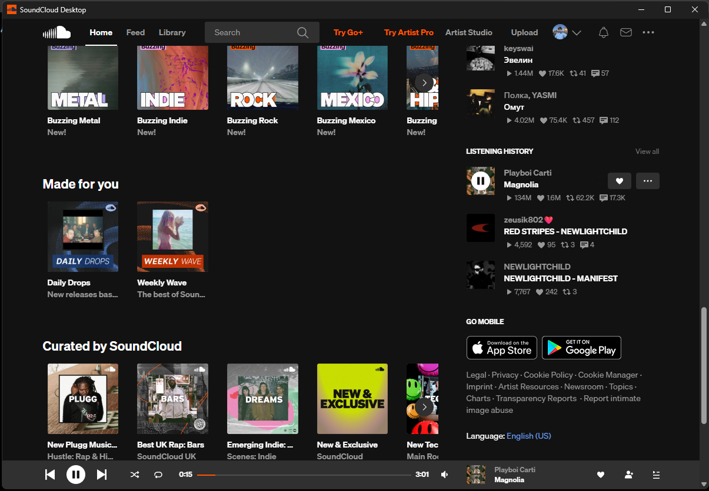

<div align="center">

# SoundCloud Desktop

### SoundCloud in a focused Windows desktop window.

A lightweight desktop wrapper that opens the SoundCloud website in a Tauri-powered WebView2 window, with a system tray and a small set of window controls.


## Preview

<p align="center">
  
</p>

</div>

## Contents

- [Overview](#overview)
- [Features](#features)
- [Technology stack](#technology-stack)
- [Installation](#installation)
- [Building from source](#building-from-source)
- [Project structure](#project-structure)
- [Configuration and data](#configuration-and-data)
- [Roadmap](#roadmap)
- [Troubleshooting](#troubleshooting)
- [Contributing](#contributing)
- [License](#license)
- [Acknowledgements](#acknowledgements)

## Overview

SoundCloud Desktop is a small Windows desktop application for opening [SoundCloud](https://soundcloud.com) in its own application window. It is built with Tauri 2 and Rust, and renders the SoundCloud website using the Microsoft Edge WebView2 runtime.

This is a desktop shell around the website, not a separate streaming client: SoundCloud provides the playback experience and account features. The app adds a dedicated window, persistent WebView data, basic window settings, and system-tray controls without requiring a regular browser tab.

The project is independent and is not affiliated with, endorsed by, or officially supported by SoundCloud.

## Features

### Website and window

- Opens `https://soundcloud.com` in the main WebView.
- Remembers the main window's size, position, and windowed/fullscreen mode.
- Offers preset window sizes and a custom size; the minimum supported size is 800 × 600.
- Uses a persistent WebView2 data directory so website data can survive app restarts.

### System tray

- Tray menu actions to show the app, open Settings, or quit.
- Left-clicking the tray icon toggles the main window's visibility.
- Optional settings to minimize to the tray when closing and start minimized.

### Keyboard shortcuts

| Shortcut | Action |
| --- | --- |
| `F11` | Toggle fullscreen |
| `Ctrl+,` | Open Settings |
| `Esc` (in Settings) | Close Settings |

`F11` and `Ctrl+,` are registered as global shortcuts. `Esc` closes the Settings window when it is focused.

## Technology stack

- **Tauri 2** hosts the desktop windows and native integrations.
- **Rust** implements window commands, settings persistence, shortcuts, and the tray.
- **Microsoft Edge WebView2** displays the SoundCloud website on Windows.
- **TypeScript** implements the Settings interface and calls native commands through the Tauri API.
- **Vite** serves the frontend during development and builds the frontend assets.

The Rust side also registers Tauri's opener, global-shortcut, and notification plugins. The current UI does not expose a notification feature.

The native application and frontend package version is `1.0.1`, matching the Cargo and Tauri configuration.

## Installation

Prebuilt binaries are not currently available. For now, [build the app from source](#building-from-source). When release downloads are published, this section can link to the verified GitHub Releases page.

## Building from source

The instructions below are for Windows, which is the platform explicitly configured for WebView2. Support for other platforms is not established by this repository. Before building, install:

- [Node.js](https://nodejs.org/) with npm.
- [Rust](https://www.rust-lang.org/tools/install) using `rustup`.
- The Windows C++ build tools required by Tauri (MSVC / Visual Studio Build Tools).
- Microsoft Edge WebView2 Runtime. The Windows bundle is configured to use Tauri's WebView2 bootstrapper when installing a packaged app.

Clone the repository, substituting its actual clone URL:

```powershell
git clone <repository-url>
cd SoundCloud-Desktop
npm ci
```

Run the app in development mode:

```powershell
npm run tauri -- dev
```

Create a production build:

```powershell
npm run tauri -- build
```

The Tauri commands invoke the configured Vite development or build steps. `npm run build` by itself builds only the frontend; use the Tauri build command to produce the desktop application. Tauri build artifacts are written beneath `src-tauri\target\`; Windows installer bundles, when successfully generated, are placed under `src-tauri\target\release\bundle\`.

## Project structure

```text
.
├── index.html                 # Main frontend entry point
├── settings.html              # Settings window entry point
├── src/
│   ├── main.ts                # Minimal main-window frontend entry
│   ├── settings.ts            # Settings UI and native command calls
│   ├── settings.css           # Settings window styles
│   └── style.css              # Main entry styles
├── src-tauri/
│   ├── src/
│   │   ├── main.rs            # App setup, main WebView, shortcuts, window events
│   │   ├── commands.rs        # Window, settings, and tray commands
│   │   ├── state.rs           # Settings state and persistence
│   │   └── modules/tray.rs    # Tray icon, menu, and tray settings
│   ├── icons/                 # Application icons
│   ├── Cargo.toml              # Rust package and dependencies
│   ├── Cargo.lock              # Locked Rust dependency versions
│   └── tauri.conf.json         # Tauri windows, frontend, and bundle configuration
├── package.json                # Frontend scripts and dependencies
├── package-lock.json           # Locked npm dependency versions
└── vite.config.ts              # Frontend build configuration
```

## Configuration and data

When the Windows `APPDATA` environment variable is set, the app uses `%APPDATA%\SoundCloud-Desktop` for its WebView2 data directory and JSON settings. If `APPDATA` is unavailable, the Rust implementation falls back to a relative `SoundCloud-Desktop` directory under the current working directory.

- `settings.json` stores window size, position, and display mode.
- `tray_settings.json` stores the minimize-to-tray and start-minimized choices.
- WebView2 stores its website profile data in the configured data directory; this may include SoundCloud session data.

Treat this directory as user data. Removing or replacing it may reset application preferences and sign you out of SoundCloud.

## Roadmap

No public roadmap or planned feature list is currently documented in the repository. The features above describe the implementation present in the source.

## Troubleshooting

- **The app does not open SoundCloud:** Check that the device is online and that SoundCloud is reachable in a browser. The app displays the live website and does not provide offline playback.
- **A packaged app cannot start its WebView:** Confirm that WebView2 Runtime is installed. The Windows bundle is configured to use Tauri's bootstrapper, which may need network access during installation.
- **A development build fails before Rust compilation:** Check that the Rust toolchain and the MSVC C++ build tools required by Tauri are installed.
- **A sign-in flow does not complete:** Authentication is handled by the SoundCloud website inside WebView2. Third-party sign-in and popup behavior can vary and have not been verified for every provider.
- **Window settings or site state appear reset:** Check `%APPDATA%\SoundCloud-Desktop` and ensure the app can write to it. Avoid deleting the directory unless you intend to reset preferences and WebView data.

## Contributing

Contributions are welcome. A straightforward workflow is:

1. Fork the repository and create a branch for your change.
2. Install dependencies with `npm ci`.
3. Run the app with `npm run tauri -- dev` and verify the affected behavior.
4. Run `npm run build` to check the frontend build.
5. Open a pull request describing the change and any relevant testing.

Keep changes focused and avoid presenting unimplemented or unverified integrations as working features.

## License

There is no `LICENSE` file in the repository. `Cargo.toml` contains `license = "MIT"`, but the intended project license has not been confirmed. This README does not claim that the repository is licensed under MIT; add a license file only after the maintainers confirm the intended terms.

SoundCloud and its logo are trademarks of their respective owner. This project is an independent, unofficial application and is not affiliated with or endorsed by SoundCloud.

## Acknowledgements

This application uses [Tauri](https://tauri.app/), [Rust](https://www.rust-lang.org/), [TypeScript](https://www.typescriptlang.org/), [Vite](https://vite.dev/), and [Microsoft Edge WebView2](https://developer.microsoft.com/microsoft-edge/webview2/). SoundCloud's website is displayed within the app; SoundCloud is not a project partner.
